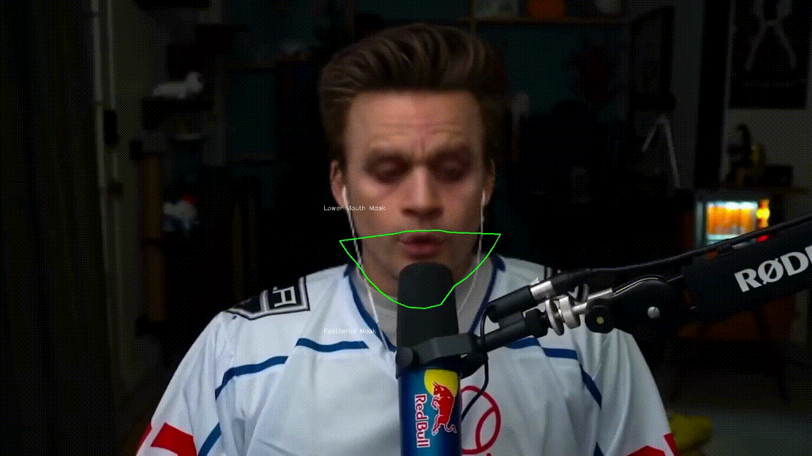

<p align="center">
  
</p>

<h1 align="center">Deep-Live-Cam 中文版（deep-live-cam-zh）</h1>

<p align="center"><b>实时 AI 换脸：只需一张照片，单张 RTX 4090 也能实时运行。</b></p>

> **这是什么**：本仓库是 [hacksider/Deep-Live-Cam](https://github.com/hacksider/Deep-Live-Cam)（AGPL-3.0，约 10 万★）的非官方简体中文汉化版。README 已译为中文；代码、注释与 `locales/` 保持英文原文。**依 AGPL-3.0 第 5(a) 条声明：本仓库对上游的修改为 README 文档翻译**，并以相同 AGPL-3.0 许可发布。同步基线：上游 2026-11 快照。翻译 by [@bayshier](https://github.com/bayshier)。
>
> **⚠️ 使用前必读**：本工具面向 AI 生成媒体行业的正当用途。使用真实人物面部必须获得本人同意，公开分享时必须明确标注为深度合成（deepfake）内容。详见下方[免责声明](#免责声明)。

**[上游英文原版](https://github.com/hacksider/Deep-Live-Cam)** · [快速开始](#三步上手) · [安装](#安装手动) · [命令行参数](#命令行参数未维护)

## 免责声明

本深度合成（deepfake）软件旨在成为 AI 生成媒体行业的高效工具。它可以协助艺术家为自定义角色制作动画、创作引人入胜的内容，甚至将模型用于服装设计。

我们深知此类技术存在被滥用的可能，并致力于采取预防措施：程序内置检查机制，会拒绝处理不当媒体（裸露、血腥内容、战争片段等敏感素材）。我们将继续以负责任的方式开发本项目，遵守法律与道德规范。如法律要求，我们可能关停项目或为输出添加水印。

- **道德使用**：用户应以负责任且合法的方式使用本软件。使用真实人物面部时，必须取得本人同意；在线分享任何输出内容时，必须明确标注其为深度合成内容。
- **内容限制**：软件内置检查机制，防止处理不当媒体（裸露、血腥内容或敏感素材）。
- **法律合规**：我们遵守一切相关法律与道德准则。如法律要求，我们可能关停项目或为输出添加水印。
- **用户责任**：我们对最终用户的行为不承担责任。用户必须确保自己的使用符合道德标准与法律要求。

使用本软件即表示你同意上述条款，并承诺以尊重他人权利与尊严的方式使用它。

## Deep-Live-Cam 2.8 Ultimate 预编译版！

不想折腾环境？官方提供预编译版本（含模型），前往上游 README 的 [Pre-built 段落](https://github.com/hacksider/Deep-Live-Cam#pre-built-deep-live-cam-28-ultimate)获取下载链接与说明。

## 三步上手


1. 选择一张人脸照片
2. 选择摄像头
3. 按下 Live！

## 功能与用途——全部实时

### 嘴部遮罩（Mouth Mask）

**使用嘴部遮罩保留你原本的嘴型，说话更精准**

<p align="center">
  
</p>

### 人脸映射（Face Mapping）

**同时为画面中的多个对象指定不同人脸**

<p align="center">
  
</p>

### 你的电影，你的脸

**实时观看任何主视角人脸的电影**

<p align="center">
  
</p>

### 直播演出

**运行直播节目与表演**

<p align="center">
  
</p>

### 表情包

**打造你的下一个爆款表情包**

<p align="center">
  
  <br>
  <sub>使用 Deep-Live-Cam 的 Many Faces（多脸）功能制作</sub>
</p>

### Omegle

**给 Omegle 上的陌生人一点惊喜**

<p align="center">
  <video src="https://github.com/user-attachments/assets/2e9b9b82-fa04-4b70-9f56-b1f68e7672d0" width="450" controls></video>
</p>

## 安装（手动）

**请注意：手动安装需要一定技术能力，不适合新手。请优先考虑上方的预编译版。**

<details>
<summary>点开查看安装过程</summary>

此方式兼容性更好，但使用 CPU，速度较慢。

**1. 准备平台环境**

-   Python（推荐 3.14；支持 3.11-3.14）
-   pip
-   git
-   [ffmpeg](https://www.youtube.com/watch?v=OlNWCpFdVMA) - ```iex (irm ffmpeg.tc.ht)```
-   [Visual Studio 2022 运行时（Windows）](https://visualstudio.microsoft.com/visual-cpp-build-tools/)

**2. 克隆仓库**

```bash
git clone --depth 1 https://github.com/hacksider/Deep-Live-Cam.git
cd Deep-Live-Cam
```

**3. 下载模型**

1. [gfpgan-1024.onnx](https://huggingface.co/hacksider/deep-live-cam/resolve/main/gfpgan-1024.onnx)
2. [inswapper\_128\_fp16.onnx](https://huggingface.co/hacksider/deep-live-cam/resolve/main/inswapper_128_fp16.onnx)

将这两个文件放入「**models**」文件夹。

**4. 安装依赖**

强烈建议使用 `venv` 虚拟环境避免环境问题。

Windows：
```bash
python -m venv venv
venv\Scripts\activate
pip install -r requirements.txt
```
Linux：
```bash
# 确保使用已安装的 Python 3.14
python3 -m venv venv
source venv/bin/activate
pip install -r requirements.txt
```
macOS：
```bash
# 确保使用已安装的 Python 3.14
python3 -m venv venv
source venv/bin/activate
pip install -r requirements.txt
```

**5. 运行**

```bash
python run.py
```

遇到 `gfpgan`、`basicsr` 相关报错时的修复方法见上游 README 的 [gfpgan and basicsr issue fix](https://github.com/hacksider/Deep-Live-Cam#gfpgan-and-basicsr-issue-fix)。

**遇到问题？** 常见问题清单见上游 [Issues 页面](https://github.com/hacksider/Deep-Live-Cam/issues)；先搜索再提问。

</details>

## GPU 加速

上游 README 的 [GPU Acceleration 段落](https://github.com/hacksider/Deep-Live-Cam#gpu-acceleration)按平台给出完整命令（命令为英文原样可直接执行）：

- **CUDA（NVIDIA 显卡）**：`pip uninstall onnxruntime onnxruntime-gpu` 后按 CUDA 版本安装 `onnxruntime-gpu==1.16.3`（CUDA 11.8）或 `onnxruntime-gpu==1.18.3`（CUDA 12.x），并以 `--execution-provider cuda` 运行
- **DirectML（AMD/Intel Windows）**：`pip install onnxruntime-directml==1.15.1.` + `--execution-provider dml`
- **CoreML（Apple Silicon）**：`pip install onnxruntime-silicon==1.13.1` + `--execution-provider coreml`
- **OpenVINO（Intel CPU/集显）**：`onnxruntime-openvino` 版本需与 OpenVINO 版本配对（如 1.24.1 ↔ 2025.4.1）+ `--execution-provider openvino`

完整命令与版本配对表以上游原文为准。

## 使用方法

**1. 图片/视频模式**

-   运行 `python run.py`
-   选择源人脸图片与目标图片/视频
-   点击「Start」
-   输出会保存在以目标视频命名的目录中

**2. 摄像头实时模式**

-   运行 `python run.py`
-   选择源人脸图片
-   点击「Live」
-   等待预览出现（10-30 秒）
-   用 OBS 等屏幕采集工具推流
-   更换人脸：选择新的源图片即可

## 模型下载

全部模型在这个 Hugging Face 链接：[**hacksider/deep-live-cam**](https://huggingface.co/hacksider/deep-live-cam/tree/main)

## 命令行参数（上游未再维护）

```
options:
  -h, --help                                               show this help message and exit
  -s SOURCE_PATH, --source SOURCE_PATH                     select a source image
  -t TARGET_PATH, --target TARGET_PATH                     select a target image or video
  -o OUTPUT_PATH, --output OUTPUT_PATH                     select output file or directory
  --frame-processor FRAME_PROCESSOR [FRAME_PROCESSOR ...]  frame processors (choices: face_swapper, face_enhancer, ...)
  --keep-fps                                               keep original fps
  --keep-audio                                             keep original audio
  --keep-frames                                            keep temporary frames
  --many-faces                                             process every face
  --map-faces                                              map source target faces
  --mouth-mask                                             mask the mouth region
  --video-encoder {libx264,libx265,libvpx-vp9}             adjust output video encoder
  --video-quality [0-51]                                   adjust output video quality
  --live-mirror                                            the live camera display as you see it in the front-facing camera frame
  --live-resizable                                         the live camera frame is resizable
  --max-memory MAX_MEMORY                                  maximum amount of RAM in GB
  --execution-provider {cpu} [{cpu} ...]                   available execution provider (choices: cpu, ...)
  --execution-threads EXECUTION_THREADS                    number of execution threads
  -v, --version                                            show program's version number and exit
```

需要 CLI 模式？传 `-s/--source` 参数即进入命令行模式。

## 媒体报道

- [**Ars Technica**](https://arstechnica.com/information-technology/2024/08/new-ai-tool-enables-real-time-face-swapping-on-webcams-raising-fraud-concerns/) - *「Deep-Live-Cam 爆火：任何人都能成为数字分身」*
- [**Yahoo!**](https://www.yahoo.com/tech/ok-viral-ai-live-stream-080041056.html) - *「这个爆火的 AI 直播软件确实令人胆寒」*
- [**CNN Brasil**](https://www.cnnbrasil.com.br/tecnologia/ia-consegue-clonar-rostos-na-webcam-entenda-funcionamento/) - *「AI 可克隆摄像头前的人脸」*
- [**TechLinked (Linus Tech Tips)**](https://www.youtube.com/watch?v=wnCghLjqv3s&t=551s) - *「它们在姿态、表情甚至光照匹配上做得相当好」*
- [**PetaPixel**](https://petapixel.com/2024/08/14/deep-live-cam-deepfake-ai-tool-lets-you-become-anyone-in-a-video-call-with-single-photo-mark-zuckerberg-jd-vance-elon-musk/) - *「一张照片就能让你在视频通话里变成任何人」*

完整报道清单见[上游原文](https://github.com/hacksider/Deep-Live-Cam#press)。

## 致谢

- [ffmpeg](https://ffmpeg.org)：让视频相关操作变得简单
- [Henry](https://github.com/henryruhs)：本仓库主要贡献者之一
- [deepinsight](https://github.com/deepinsight)：其 [insightface](https://github.com/deepinsight/insightface) 项目提供了优秀的库与模型。**注意：该模型仅供非商业研究用途使用**
- [s0md3v](https://github.com/s0md3v/roop)：本代码的原始作者（roop）
- 以及全部[贡献者](https://github.com/hacksider/Deep-Live-Cam/graphs/contributors)与让本项目爆火的每一位用户 ❤️

完整致谢清单见[上游原文](https://github.com/hacksider/Deep-Live-Cam#credits)。

## 许可证与合规

- 本仓库与上游均以 **AGPL-3.0** 许可发布（见 [LICENSE](LICENSE)）；本仓库的修改仅限 README 文档翻译，已按许可证第 5(a) 条声明。
- 模型版权独立：insightface 模型**仅供非商业研究用途**，商用需另行获得授权。
- 深度合成内容的使用请遵守你所在司法辖区的法律（在中国境内适用《互联网信息服务深度合成管理规定》：对生成内容显著标识、不得用于侵害他人肖像权与名誉权等情形）。
